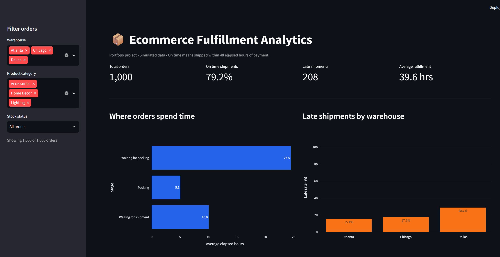

# Ecommerce Fulfillment Analytics

An analysis of shipment delays using Python, SQL, and an interactive Streamlit dashboard.

## Dashboard Preview


.png)

## Live Dashboard

[Open the interactive dashboard](https://ecommerce-process-analytics-mufqyffufj6xnaus6gsx3b.streamlit.app/)

## Business Question

Where do orders spend the most time, and which operational issues should be investigated to improve on time shipping?

The fictional store's shipping target is within 48 elapsed hours of payment confirmation, including weekends. Exactly 48 hours counts as on time.

## Dataset

This project uses 1,000 simulated completed orders and 6,000 events across three warehouses and three product categories.

Each order has six events:

1. Order placed
2. Payment confirmed
3. Packing started
4. Packing completed
5. Order shipped
6. Order delivered

A fixed random seed makes the data generation repeatable.

Inventory delays, additional Dallas queue time, and longer packing times for Lighting were deliberately included in the simulation. These are not real company records.

## Tools

Python, pandas, SQLite, SQL, Streamlit, and Plotly.

## Key Results

| Metric | Result |
|---|---:|
| Total orders | 1,000 |
| On time shipment rate | 79.2% |
| Late shipments | 208 |
| Average fulfillment time | 39.6 hours |
| Median fulfillment time | 34.1 hours |
| Average wait before packing | 24.5 hours |

Fulfillment time is measured from payment confirmation to shipment, not delivery.

## Findings

1. Waiting before packing represented approximately 62% of average fulfillment time.
2. Of 208 late orders, 154 had stock issues, accounting for 74.0% of late shipments.
3. Orders with stock issues had a 98.7% late rate, compared with 6.4% for orders without stock issues.
4. Among orders without stock issues, Dallas had a 16.9% late rate, compared with 0.7% in Chicago and 0.0% in Atlanta.
5. Dallas orders without stock issues waited 24.1 hours before packing, compared with 12.7 hours in Chicago and 12.9 hours in Atlanta.

## Proposed Business Actions

| Priority | Proposed action | Measurement |
|---|---|---|
| 1 | Investigate inventory accuracy and replenishment; flag affected orders early | Stock issue frequency and late shipment rate |
| 2 | Review Dallas staffing, order volume, and queue assignments by shift | Packing wait time and on time shipment rate |
| 3 | Pilot alerts for unshipped orders approaching the 48 hour deadline | On time shipment rate before and after the pilot |

These are recommendations for further investigation and testing. No operational improvements or cost savings have been implemented or measured.

## Dashboard Features

1. Warehouse, product category, and stock status filters.
2. KPI cards that update with the selected filters.
3. Average time by fulfillment stage.
4. Late shipment rates by warehouse.
5. Fulfillment duration distribution with a 48 hour deadline marker.
6. Stock issue comparisons.
7. Individual order exploration and filtered CSV download.
8. A clear message when no orders match the selected filters.

## Validation

Python checks cover missing values, invalid timestamps, duplicate order IDs, repeated activities, matching order IDs across files, complete event sequences, and chronological order.

SQL independently recalculates fulfillment time from the original event records.

The four SQL summary KPIs matched Python results. An automated comparison also confirmed that all six warehouse and stock condition groups matched at the displayed precision.

Manual dashboard checks confirmed:

1. Default KPI cards matched the analysis.
2. Dallas without stock issues showed 308 orders, 83.1% on time, 52 late shipments, and 39.6 average fulfillment hours.
3. Clearing all warehouse selections displayed the expected empty results message.

## Project Files

| File | Purpose |
|---|---|
| generate_data.py | Generate simulated orders and event records |
| analyze_data.py | Validate data, calculate metrics, and export summaries |
| run_sql.py | Load SQLite tables, run queries, and compare results |
| warehouse_analysis.sql | Compare warehouses within each stock condition |
| app.py | Run the interactive dashboard |
| requirements.txt | Record installed Python package versions |
| data/ | Store source data, analysis outputs, and SQLite database |

## Run Locally

Developed using Python 3.13.3 on Windows.

Run these commands from the project folder:

```powershell
python -m venv .venv
.\.venv\Scripts\python.exe -m pip install -r requirements.txt
.\.venv\Scripts\python.exe generate_data.py
.\.venv\Scripts\python.exe analyze_data.py
.\.venv\Scripts\python.exe run_sql.py
.\.venv\Scripts\python.exe -m streamlit run app.py
```

Generating the data again overwrites the generated source CSV files. Run the analysis and SQL scripts afterward to refresh their outputs.

## Limitations

This is a simulated portfolio case study with deliberately introduced patterns. Results cannot be generalized to real businesses.

All orders are completed and follow the same six steps. The dataset does not model open orders, cancellations, returns, or repeated processing steps.

Comparisons describe associations in the simulated data. Real operational decisions would require additional evidence, stakeholder input, and pilot testing.

## AI Assistance

AI assisted with code generation, dashboard design, and explanations. The project was run locally, results were compared between Python and SQL, and selected dashboard behaviors were manually checked.

## Author

[Hassaan Hameedi](https://www.linkedin.com/in/hassaan-hameedi-87172a2a3)